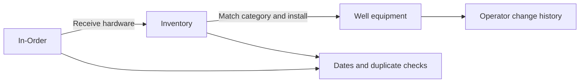

# ELMA-IoT MIE · Android

### Wellhead equipment records, adapted for the field

MIE is being adapted from Windows to Android for subsea wellhead hardware and consumables tracking. The Android interface is designed for portrait phones, rotating screens, foldables and tablets, with offline project work at its center.

**Status: initial private review, version 0.1.0.** This is not yet the full Windows application or a Google Play release. Android APKs and source are held in the organization's private repository; this public repository distributes information and optional data packs.

## Equipment through its lifecycle

The initial review implements receiving and installation checks, overdue arrival dates, duplicate serial review, undo/redo, operator history, search/replace and Excel/project copy transfer. The interface expands from a phone list to a list and details view on larger screens. Android's document picker keeps file access under the user's control.

## Optional offline content

Open **Menu → Packs** inside the application to download the combined language pack or user guide and walkthrough. Installed content is then available offline. Download progress is displayed in the app; interrupted or invalid downloads do not become installed packs.

| Content | Distribution |
|---|---|
| Languages | One combined pack; native language names |
| User guide and walkthrough | Download once, use offline |
| Future larger illustrations/media | Data packs as the corresponding viewers are ported |

[Published content catalog and pack assets](https://github.com/elma-iot/ELMA-IoT-MIE-Android/releases/tag/android-content-v1)

Catalogs are signed and downloads checked against SHA-256. Android content packs contain data/media only; executable functionality is delivered with the application. The application does not need downloaded content to add or move equipment offline.

## Compatibility and current limits

The review targets Android 16 and is configured for Android 8 or later. Physical device, accessibility and Google Play acceptance testing are still pending. Some older devices may not provide acceptable performance for large projects.

Windows native drawing rendering, PDF/GLB viewing, incremental LAN/cloud sync, custom Theme Studio themes and complete tutorial/localization parity are still being ported. Windows encrypted or LZMS projects require a separate unencrypted transfer copy; original protected files remain unchanged. Project copies are independent transfers, not automatic synchronization.

Guide content is initially English. Published Windows translations provide common labels; Android-specific translations are being reviewed.

## Feedback

Please report the Android version, device/screen size, exact steps and a synthetic example when possible. Do not post customer projects, license material or private operational data in public issues.

© ELMA-IoT. Publication here does not grant redistribution rights to application code or third-party assets.
